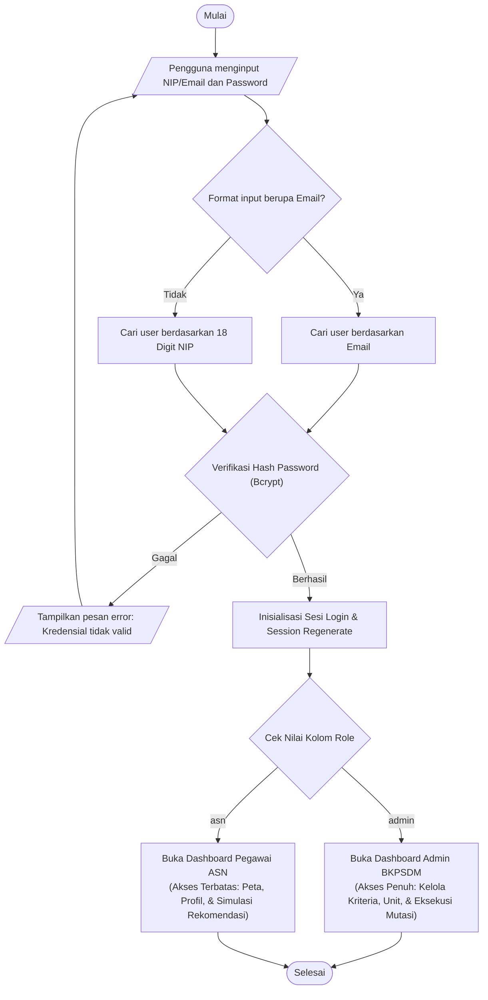
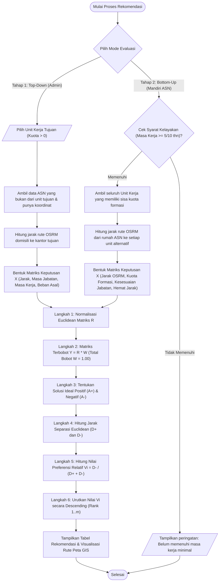
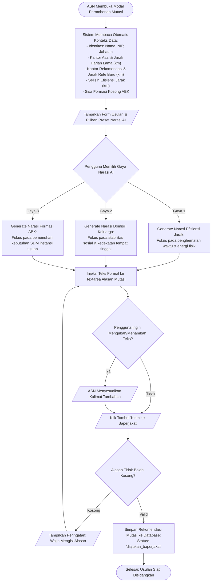
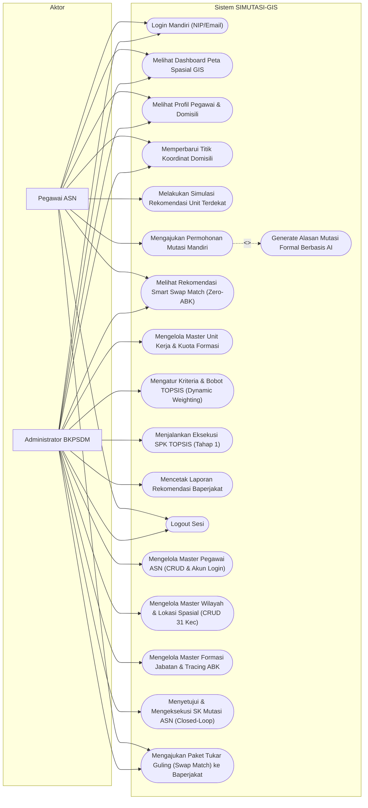
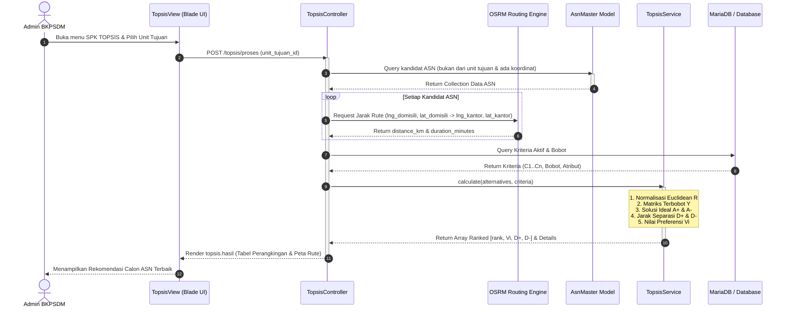
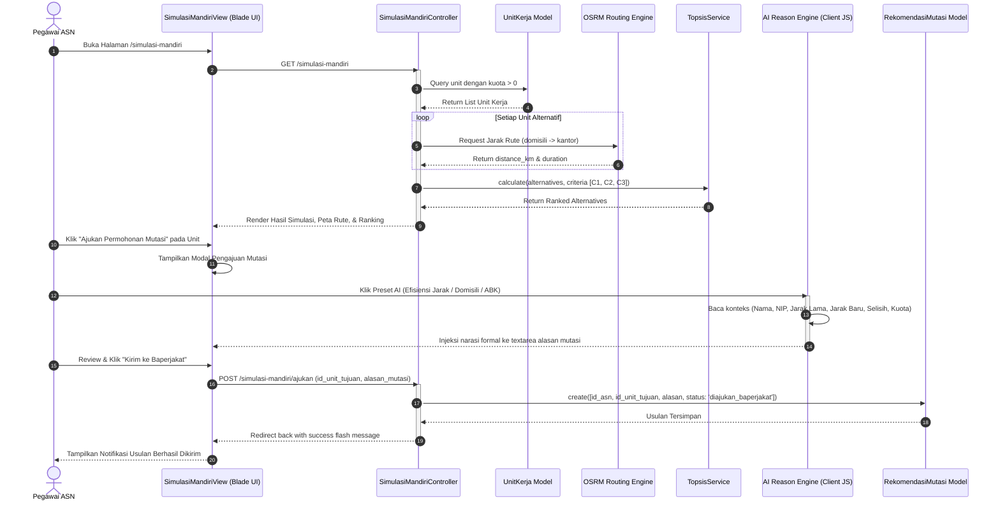
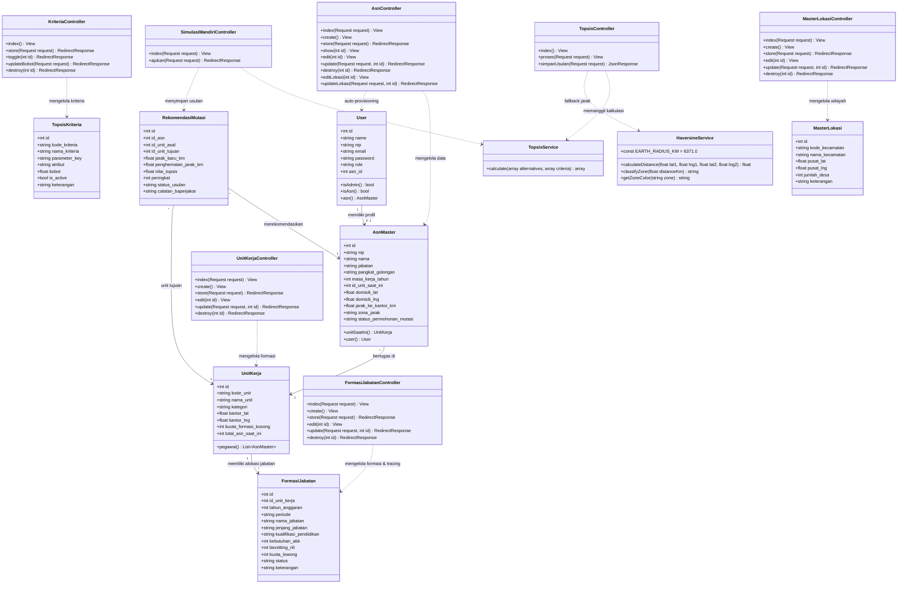
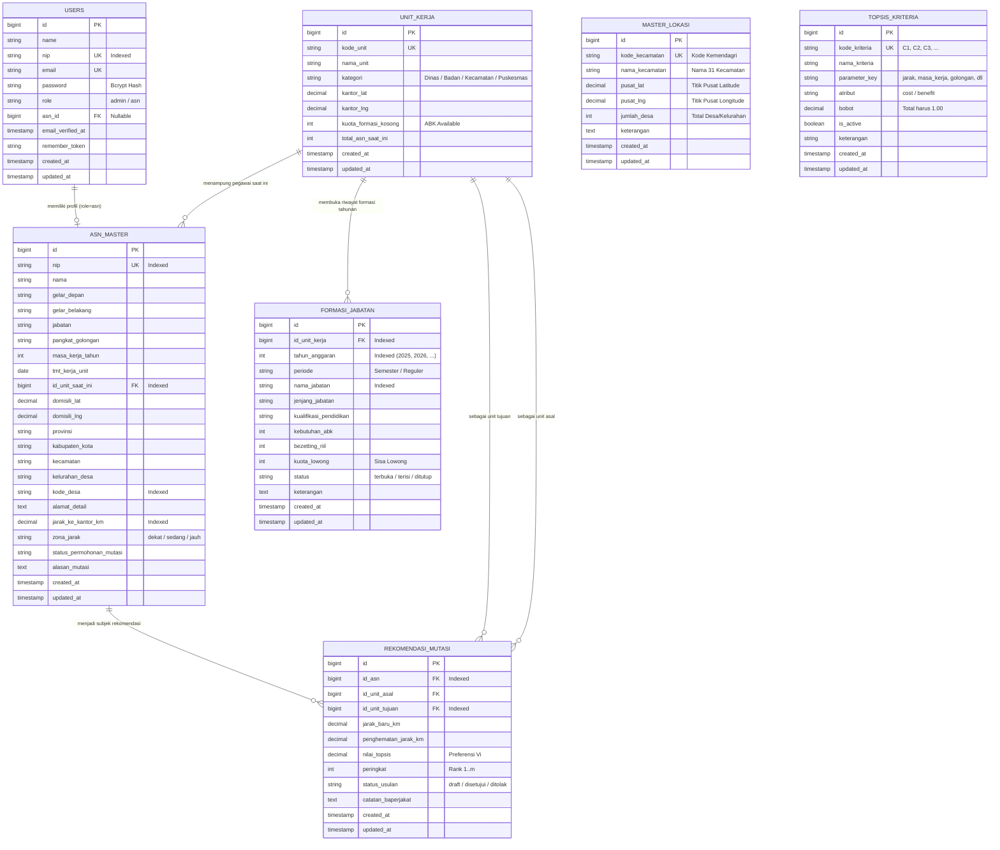

# DOKUMEN PERANCANGAN SISTEM (BAB 3 SKRIPSI)
## UML, Flowchart, dan Entity-Relationship Diagram (ERD) Sistem Independen SIMUTASI-GIS

> **Peruntukan Dokumen:** Bab 3 Metodologi & Perancangan Sistem pada Naskah Skripsi.  
> **Karakteristik Sistem:** Sistem Independen (*Standalone*) dengan Autentikasi Mandiri (Role-Based Access Control: Admin BKPSDM vs Pegawai ASN), Mesin Komputasi Spasial OSRM/Haversine, dan SPK TOPSIS 2-Tahap.

---

## 1. Flowchart Sistem

### 1.1 Flowchart Autentikasi Mandiri & Kontrol Akses (RBAC)

---

### 1.2 Flowchart Komputasi SPK TOPSIS 2-Tahap

---

### 1.3 Flowchart Alur Asisten AI Context-Aware Smart Reason Generator

---

## 2. Diagram UML (Unified Modeling Language)

### 2.1 Use Case Diagram (Sistem Independen SIMUTASI-GIS)

---

### 2.2 Sequence Diagram: Proses Eksekusi SPK Rekomendasi Mutasi

---

### 2.3 Sequence Diagram: Simulasi Penempatan Mandiri & Pengajuan Mutasi Berbantuan AI

---

### 2.4 Class Diagram (Arsitektur MVC & Service Layer)

---

## 3. Entity-Relationship Diagram (ERD) Relasional

### 3.1 Diagram ERD

---

## 4. Kamus Data Database (Data Dictionary untuk Bab 3)

### Tabel `users` (Akun Pengguna Mandiri)
| Nama Kolom | Tipe Data | Kunci | Nullable | Deskripsi |
| :--- | :--- | :---: | :---: | :--- |
| `id` | BIGINT UNSIGNED | PK | No | Identifikator unik akun |
| `name` | VARCHAR(255) | - | No | Nama lengkap pengguna |
| `nip` | VARCHAR(25) | UK | Yes | Nomor Induk Pegawai 18 digit (kredensial login ASN) |
| `email` | VARCHAR(255) | UK | No | Alamat email resmi dinas |
| `password` | VARCHAR(255) | - | No | Hash kata sandi terenkripsi (Bcrypt) |
| `role` | VARCHAR(20) | - | No | Peran otorisasi: `admin` (BKPSDM) atau `asn` (Pegawai) |
| `asn_id` | BIGINT UNSIGNED | FK | Yes | Relasi ke baris tabel `asn_master.id` |

### Tabel `unit_kerja` (Master Kantor & Formasi ABK)
| Nama Kolom | Tipe Data | Kunci | Nullable | Deskripsi |
| :--- | :--- | :---: | :---: | :--- |
| `id` | BIGINT UNSIGNED | PK | No | Identifikator unik unit kerja |
| `kode_unit` | VARCHAR(50) | UK | No | Kode resmi SKPD/Instansi |
| `nama_unit` | VARCHAR(255) | - | No | Nama instansi kantor dinas/puskesmas/kecamatan |
| `kantor_lat` | DECIMAL(10,8) | - | No | Titik lintang geografis kantor |
| `kantor_lng` | DECIMAL(11,8) | - | No | Titik bujur geografis kantor |
| `kuota_formasi_kosong` | INT | - | No | Sisa kuota kebutuhan pegawai menurut ABK ($\le 0$ dilarang mutasi masuk) |

### Tabel `topsis_kriteria` (Master Parameter & Bobot Keputusan)
| Nama Kolom | Tipe Data | Kunci | Nullable | Deskripsi |
| :--- | :--- | :---: | :---: | :--- |
| `id` | BIGINT UNSIGNED | PK | No | Identifikator kriteria |
| `kode_kriteria` | VARCHAR(10) | UK | No | Label kode kriteria ($C_1, C_2, C_3, \dots$) |
| `nama_kriteria` | VARCHAR(100) | - | No | Nama deskripsi kriteria penilaian |
| `atribut` | ENUM | - | No | Sifat kriteria: `cost` (biaya/jarak) atau `benefit` (keuntungan) |
| `bobot` | DECIMAL(5,4) | - | No | Nilai bobot kepentingan kriteria ($\sum W = 1.0000$) |
| `is_active` | BOOLEAN | - | No | Status aktif kriteria dalam kalkulasi matriks |

### Tabel `master_lokasi` (Master Wilayah & Koordinat Pusat Kecamatan)
| Nama Kolom | Tipe Data | Kunci | Nullable | Deskripsi |
| :--- | :--- | :---: | :---: | :--- |
| `id` | BIGINT UNSIGNED | PK | No | Identifikator unik wilayah |
| `kode_kecamatan` | VARCHAR(20) | UK | No | Kode wilayah standar Kemendagri (e.g. 32.12.01) |
| `nama_kecamatan` | VARCHAR(100) | - | No | Nama 31 kecamatan di Kabupaten Indramayu |
| `pusat_lat` | DECIMAL(10,8) | - | No | Koordinat lintang titik pusat wilayah kecamatan |
| `pusat_lng` | DECIMAL(11,8) | - | No | Koordinat bujur titik pusat wilayah kecamatan |
| `jumlah_desa` | INT | - | No | Jumlah desa/kelurahan dalam lingkup kecamatan |
| `keterangan` | TEXT | - | Yes | Catatan karakteristik/geografis wilayah |

