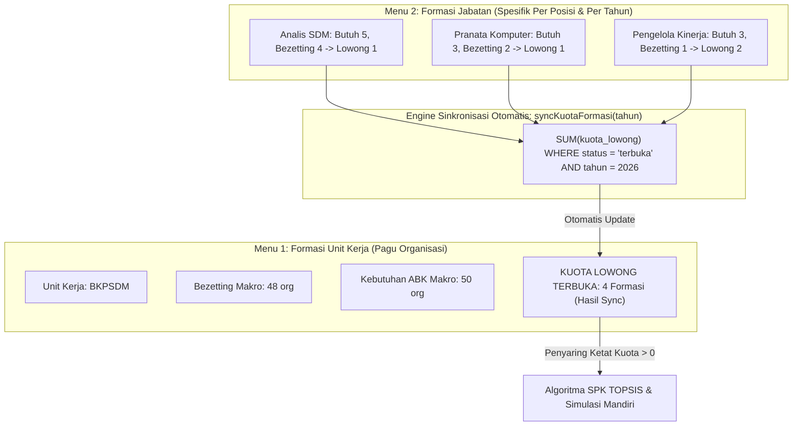

# DOKUMENTASI RESMI: ANALISIS BEBAN KERJA (ABK), BEZETTING RIIL, DAN SINKRONISASI FORMASI JABATAN
> Sistem Pendukung Keputusan Pemetaan Spasial & Rekomendasi Mutasi ASN (SIMUTASI-GIS)  
> Badan Kepegawaian dan Pengembangan Sumber Daya Manusia (BKPSDM) Kabupaten Indramayu

---

## 1. Glosarium & Definisi Istilah Kepegawaian

Dalam pengelolaan formasi ASN berdasarkan standar BKN (Badan Kepegawaian Negara) dan Kementerian PAN-RB, data formasi dibagi menjadi tiga variabel utama:

```
+-----------------------------------------------------------------------------------+
|                                  RUANG LINGKUP FORMASI                            |
|                                                                                   |
|  [ KEBUTUHAN ABK ] = Jumlah ideal pegawai berdasarkan volume beban kerja tahunan  |
|         │                                                                         |
|         ▼                                                                         |
|  [ BEZETTING RIIL ] = Jumlah ASN yang saat ini aktif menduduki jabatan tersebut   |
|         │                                                                         |
|         ▼                                                                         |
|  [ KUOTA LOWONG ] = Sisa kursi kosong yang sah untuk mutasi masuk / pengisian     |
|         │           Rumus: max(0, Kebutuhan ABK - Bezetting Riil)                 |
+-----------------------------------------------------------------------------------+
```

### A. Kebutuhan ABK (*Workload Analysis Need*)
* **Definisi:** Angka kuantitatif yang menunjukkan jumlah ideal pegawai yang dibutuhkan oleh suatu unit kerja atau jabatan berdasarkan perhitungan volume beban kerja, standar waktu penyelesaian tugas, dan jam kerja efektif dalam satu tahun anggaran.
* **Dasar Hukum:** PermenPAN-RB tentang Pedoman Analisis Beban Kerja dan Analisis Jabatan.
* **Karakteristik:** Bersifat dinamis per tahun anggaran, disahkan oleh Baperjakat dan Pejabat Pembina Kepegawaian (PPK).

### B. Bezetting Riil (*Existing Staff On Duty*)
* **Definisi:** Jumlah riil fisik pegawai ASN (PNS & PPPK) yang **saat ini sedang aktif bertugas** menduduki unit kerja atau jabatan tersebut.
* **Etimologi:** Berasal dari istilah administrasi kepegawaian Belanda *"bezetting"* yang berarti 'keterisian' atau 'tingkat okupansi'.
* **Karakteristik:** Berubah saat terjadi mutasi masuk, mutasi keluar, pensiun, atau pengangkatan baru.

### C. Kuota Lowong (*Net Vacant Slots*)
* **Definisi:** Selisih bersih antara Kebutuhan ABK dengan Bezetting Riil yang berstatus terbuka. Kuota inilah yang **secara sah dapat dialokasikan** untuk rotasi mutasi masuk pegawai atau rekrutmen ASN baru.
* **Formula Matematis:**
  $$\text{Kuota Lowong} = \begin{cases} \max(0, \text{Kebutuhan ABK} - \text{Bezetting Riil}) & \text{jika status = 'terbuka'} \\ 0 & \text{jika status } \in \{\text{'terisi'}, \text{'ditutup'}\} \end{cases}$$

### D. Formasi Terbuka, Terisi, dan Ditutup
* **Terbuka (*Open*):** Jabatan memiliki kuota lowong $> 0$ dan aktif menerima usulan mutasi masuk pada tahun anggaran berjalan.
* **Terisi (*Fulfilled*):** Seluruh kuota lowong telah terpenuhi ($\text{Bezetting} = \text{Kebutuhan}$), biasanya terjadi pada rekaman historis tahun-tahun sebelumnya.
* **Ditutup (*Frozen / Closed*):** Formasi tidak dibuka untuk mutasi oleh kebijakan Baperjakat (misal: penataan organisasi / moratorium jabatan).

---

## 2. Arsitektur Sinkronisasi Dua Level (Makro Unit vs Mikro Jabatan)

Pada SIMUTASI-GIS terdapat 2 menu manajemen formasi yang saling terintegrasi:



### Mekanisme Sinkronisasi Kode:
1. Setiap kali formasi jabatan ditambah (`store`), diperbarui (`update`), atau dihapus (`destroy`) di `FormasiJabatanController`, sistem memanggil:
   ```php
   $unit->syncKuotaFormasi((int)$validated['tahun_anggaran']);
   ```
2. Method `syncKuotaFormasi()` pada `App\Models\UnitKerja` menghitung total kuota jabatan terbuka:
   ```php
   $totalKuota = $this->formasiJabatan()
       ->where('tahun_anggaran', $tahun)
       ->where('status', 'terbuka')
       ->sum('kuota_lowong');
   $this->update(['kuota_formasi_kosong' => $totalKuota]);
   ```
3. Kolom **KUOTA LOWONG** di Menu Unit Kerja langsung mencerminkan ketersediaan riil formasi spesifik yang sedang dibuka di tahun berjalan.

---

## 3. Matriks Kasus (Case Scenarios) Kepegawaian

Berikut adalah skenario nyata di BKPSDM dan bagaimana sistem meresponsnya:

### Kasus 1: Kondisi Normal (*Understaffing* - Ada Lowongan)
* **Kondisi:**
  - Instansi: Kantor Kecamatan Haurgeulis
  - Jabatan: Analis Tata Pemerintahan
  - Kebutuhan ABK: $4\text{ orang}$
  - Bezetting Riil: $2\text{ orang}$
* **Kalkulasi Sistem:**
  $$\text{Kuota Lowong} = 4 - 2 = \mathbf{2\text{ kursi}}$$
* **Respon Sistem:**
  - Status formasi: `Terbuka`.
  - Unit Kerja Kecamatan Haurgeulis memiliki kuota $> 0$.
  - ASN yang domisili dekat Haurgeulis dapat melihat unit ini di menu **Simulasi Mandiri** dan SPK TOPSIS menilainya sebagai kandidat tujuan mutasi.

---

### Kasus 2: Kondisi Penuh (*Zero Vacancy* / Terisi Penuh)
* **Kondisi:**
  - Instansi: RSUD Indramayu
  - Jabatan: Perawat Ahli Pertama
  - Kebutuhan ABK: $25\text{ orang}$
  - Bezetting Riil: $25\text{ orang}$
* **Kalkulasi Sistem:**
  $$\text{Kuota Lowong} = 25 - 25 = \mathbf{0\text{ kursi}}$$
* **Respon Sistem:**
  - Status formasi: `Terisi` / Label Unit: `Penuh`.
  - Unit RSUD Indramayu otomatis **dikeluarkan dari opsi rekomendasi TOPSIS mutasi masuk satu arah** untuk mencegah penumpukan pegawai.
  - *Catatan:* ASN dari unit ini hanya bisa berpindah melalui mekanisme **Swap Mutasi (Tukar Guling 1-on-1)** yang tidak mengubah total formasi instansi.

---

### Kasus 3: Kondisi Kelebihan Pegawai (*Overstaffing*)
* **Kondisi:**
  - Suatu instansi mengalami penyusutan beban kerja organisasi.
  - Kebutuhan ABK: $3\text{ orang}$, tetapi Bezetting Riil yang ada: $4\text{ orang}$.
* **Kalkulasi Sistem:**
  $$\text{Kuota Lowong} = \max(0, 3 - 4) = \mathbf{0\text{ kursi}}$$
* **Respon Sistem:**
  - Sistem menggunakan fungsi $\max(0, \dots)$, sehingga nilai tidak pernah negatif.
  - Unit ini berstatus `Penuh`, dan pegawai di unit ini diprioritaskan sebagai **kandidat mutasi keluar** (*Redistribusi ASN*) ke unit-unit terpencil yang kekurangan pegawai.

---

### Kasus 4: Siklus Mutasi Masuk Satu Pegawai (*State Mutation*)
* **Skenario:**
  1. Pegawai **Ahmad Fauzi** disetujui oleh sidang Baperjakat mutasi dari BKPSDM ke Kecamatan Haurgeulis.
  2. Eksekusi SK Mutasi dijalankan:
     - Di unit asal (BKPSDM): Bezetting berkurang $1$ $\rightarrow$ Kuota Lowong bertambah $1$.
     - Di unit tujuan (Haurgeulis): Bezetting bertambah $1$ $\rightarrow$ Kuota Lowong berkurang $1$.
  3. Total pagu pegawai Pemerintah Kabupaten Indramayu tetap seimbang (*Zero Net Increase*).

---

### Kasus 5: Tracing Historis Lintas Tahun (*Multi-Year Audit Trail*)
* **Skenario:**
  - Baperjakat ingin memeriksa: *"Apakah pada tahun 2025 RSUD Indramayu pernah membuka formasi Perawat Ahli Pertama?"*
* **Respon Sistem:**
  - Baperjakat mengklik filter pil **Tahun 2025 (Historis)** pada menu Formasi Jabatan.
  - Sistem menampilkan rekam jejak formasi tahun 2025 dengan status `Terisi` lengkap dengan catatan: *"Telah terisi penuh melalui alokasi formasi 2025."*
  - Data historis ini tidak mengganggu kuota aktif tahun 2026 yang sedang dibuka.

---

### Kasus 6: Anomali Data & Pencegahan Server-Side
* **Potensi Masalah:** Admin secara keliru memasukkan data Kebutuhan = $5$, Bezetting = $4$, namun mengetik Kuota Lowong = $4$.
* **Pencegahan Sistem (Guard Engine):**
  - Pada `FormasiJabatanController@store` dan `@update`, sistem **mengabaikan angka ketikan manual** dan menghitung ulang di server:
    ```php
    $validated['kuota_lowong'] = max(0, (int)$validated['kebutuhan_abk'] - (int)$validated['bezetting_riil']);
    ```
  - Data yang tersimpan dijamin $100\%$ valid secara aritmatika kepegawaian ($5 - 4 = 1$).

---

## 4. Rangkuman Keselarasan Antar Modul

| Parameter | Menu 1: Formasi (ABK / Bezetting) | Menu 2: Formasi Jabatan & Rekam Jejak ABK |
| :--- | :--- | :--- |
| **Fokus Informasi** | Tingkat Unit Kerja / Instansi (Makro) | Tingkat Nama Jabatan Fungsional/Struktural (Mikro) |
| **Dimensi Waktu** | Status Operasional Berjalan | Multi-Tahun (Tracing 2025, 2026, dst.) |
| **Kebutuhan ABK** | Pagu total instansi (contoh: 50 pegawai) | Pagu formasi spesifik (contoh: 5 Analis SDM) |
| **Bezetting Riil** | Total personil aktif di kantor (contoh: 48 orang) | Total personil yang memegang jabatan tersebut (contoh: 4 orang) |
| **Sumber Kuota Lowong** | **Tersinkronisasi otomatis** dari `SUM(kuota_lowong)` jabatan terbuka | Dihitung dari $\max(0, \text{ABK} - \text{Bezetting})$ per jabatan |
| **Dampak ke SPK TOPSIS** | Digunakan sebagai filter gerbang kelayakan instansi tujuan | Menentukan linearitas jabatan pegawai dengan kursi yang tersedia |

