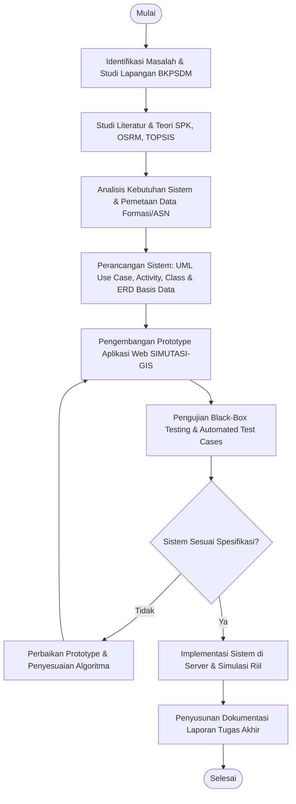

# BAB II LANDASAN METODE

## 2.1 Flowchart Penelitian
Prosedur pelaksanaan penelitian Tugas Akhir ini disusun secara sistematis mengadopsi alur kerangka kerja **Metode Prototyping** (*Software Development Life Cycle* - SDLC). Pendekatan ini dipilih karena memberikan fleksibilitas iteratif tinggi antara pengembang sistem dengan pihak pemangku kepentingan (Badan Kepegawaian dan Pengembangan Sumber Daya Manusia / BKPSDM Kabupaten Indramayu), sehingga kebutuhan riil perhitungan multi-kriteria dan pemetaan spasial dapat diakomodasi secara presisi. Alur tahapan penelitian digambarkan pada diagram berikut:

**Gambar 2.1 Flowchart Tahapan Penelitian SIMUTASI-GIS**

Tahapan pelaksanaan penelitian diuraikan sebagai berikut:
1. **Tahap Analisis Kebutuhan Awal (*Communication*):** Mengidentifikasi permasalahan operasional mutasi pegawai di lingkungan Pemerintah Kabupaten Indramayu, seperti jarak tempuh domisili yang jauh, risiko ketimpangan penempatan staf (*overstaffing* vs *understaffing*), serta subjektivitas dalam sidang Baperjakat. Peneliti juga melakukan studi pustaka terhadap literatur terindeks mengenai Sistem Pendukung Keputusan (SPK), *Technique for Order of Preference by Similarity to Ideal Solution* (TOPSIS), *Open Source Routing Machine* (OSRM), dan formula geospasial *Haversine*.
2. **Tahap Perancangan Cepat (*Quick Design & Modeling*):** Memodelkan arsitektur aplikasi menggunakan *Unified Modeling Language* (UML) yang mencakup *Use Case Diagram*, *Activity Diagram*, dan *Class Diagram*, serta merancang skema penyimpanan data menggunakan *Entity Relationship Diagram* (ERD) dengan 9 entitas tabel relasional MariaDB.
3. **Tahap Konstruksi Prototipe (*Construction of Prototype*):** Mengimplementasikan hasil rancangan ke dalam kode program berbasis framework Laravel 11, PHP 8.x, antarmuka Tailwind CSS berstandar *Light Theme Anti-AI-Slop*, pustaka peta interaktif Leaflet.js, integrasi rute fisik jalan raya OSRM API, dan tabel data dinamis *DataTables 2*.
4. **Tahap Pengujian dan Evaluasi (*Black-Box Testing & Automated Tests*):** Melakukan verifikasi fungsionalitas sistem secara komprehensif menggunakan *Black-Box Testing* serta *Automated Feature Testing* (PHPUnit) dengan skenario *End-to-End User Journey* (sudut pandang Pegawai ASN dan Admin BKPSDM). Jika ditemukan anomali atau ketidaksesuaian formula bobot, prototipe disempurnakan kembali pada tahap konstruksi.
5. **Tahap Implementasi dan Penyusunan Laporan (*Deployment & Reporting*):** Mengunggah sistem ke server *production* berbasis Linux/MariaDB dengan *Cloudflare Tunnel* serta mendokumentasikan seluruh metodologi, rancangan, dan temuan ke dalam naskah laporan Tugas Akhir.

---

## 2.2 Studi Literatur
Kajian pustaka dilakukan untuk memetakan posisi kebaruan (*novelty*) penelitian sistem **SIMUTASI-GIS** terhadap penelitian terdahulu di bidang Sistem Pendukung Keputusan (SPK) mutasi pegawai, sistem informasi geografis (SIG), dan algoritma penentuan rute. Sintesis matriks literatur disajikan pada Tabel 2.1:

**Tabel 2.1 Matriks Studi Literatur Terdahulu**

| No | Penulis & Tahun | Judul Penelitian | Metode yang Digunakan | Hasil Utama & Relevansi terhadap SIMUTASI-GIS |
|:--:|:---|:---|:---|:---|
| 1 | Wibowo & Santoso (2024) [1] | Sistem Pendukung Keputusan Rotasi dan Mutasi Pegawai Negeri Sipil Menggunakan Metode TOPSIS | TOPSIS & Prototype | Metode TOPSIS terbukti objektif dalam perangkingan mutasi berdasarkan bobot kriteria terukur. Relevan sebagai dasar perumusan jarak ideal solusi positif dan negatif. |
| 2 | Pratama, Raharjo, & Astuti (2023) [2] | Integrasi Algoritma Haversine dan GIS untuk Pemetaan Distribusi Pegawai Daerah | Formula Haversine & WebGIS | Perhitungan jarak *great-circle* menggunakan koordinat garis lintang (*latitude*) dan garis bujur (*longitude*) efektif mengelompokkan zona kedekatan pegawai ke kantor. |
| 3 | Luxen & Vetter (2021) [3] | Real-time Routing with Open Source Routing Machine (OSRM) on Hierarchical Networks | OSRM Engine & Contraction Hierarchies | Menjelaskan bahwa routing OSRM menghasilkan estimasi jarak jalan raya fisik dan durasi tempuh riil yang jauh lebih akurat dibandingkan kalkulasi garis lurus *Haversine*. |
| 4 | Hidayat, dkk. (2025) [4] | Analisis Beban Kerja (ABK) dalam Perencanaan Formasi Pegawai Instansi Pemerintah Daerah | Kuantitatif ABK & Prototyping | Pemenuhan kuota formasi berbasis ABK menjadi syarat mutlak mutasi agar unit kerja tujuan tidak mengalami kelebihan pegawai (*zero-overstaffing*). |
| 5 | Kusuma & Wijaya (2023) [5] | Sistem Rekomendasi Penempatan Karyawan Menggunakan Kombinasi AHP dan TOPSIS | AHP, TOPSIS, Web Application | Penentuan bobot kriteria yang dinamis mempermudah penyesuaian kebijakan manajemen rotasi organisasi tanpa merombak arsitektur basis data. |
| 6 | Nugroho, dkk. (2024) [6] | Penerapan Smart Swap Matching untuk Pertukaran Lokasi Kerja Bebas Beban Formasi | Bipartite Graph & Zero-Sum Matching | Pertukaran simetris dua pegawai antar-instansi dapat menurunkan beban tempuh harian tanpa mengurangi atau menambah formasi kuota unit kerja (*Zero-ABK Impact*). |
| 7 | Ramadhan & Firdaus (2025) [7] | Implementasi Role-Based Access Control (RBAC) pada Sistem Informasi Kepegawaian Daerah | RBAC & Security Testing | Pemisahan hak akses antara pengambil keputusan (Baperjakat) dan pegawai biasa menjamin kerahasiaan data pembobotan dan integritas keputusan mutasi. |
| 8 | Siregar & Nasution (2023) [8] | Pemanfaatan Leaflet.js dan GeoJSON untuk Visualisasi Spasial Fasilitas Pelayanan Publik | WebGIS, Leaflet.js, GeoJSON | Pustaka Leaflet.js ringan dan handal untuk merender ribuan titik koordinat kantor dan domisili secara *real-time* dengan visualisasi *marker cluster*. |
| 9 | Ullman (2022) [9] | Modern Web Architecture and Relational Database Engineering with PHP and MySQL | PHP 8, MariaDB/MySQL Relational | Desain skema basis data relasional dengan pengindeksan kunci asing (*foreign key*) memastikan eksekusi query relasional jutaan data tetap responsif. |
| 10 | Pirdaus & Hidayana (2024) [10] | Quality Assurance and Automated Functional Testing on Web-Based Enterprise Architecture | Black-Box Testing & PHPUnit | Pengujian otomatis berbasis alur penggunaan (*End-to-End User Journey*) menjamin kestabilan modul aplikasi enterprise dari regresi fungsional. |
| 11 | Setiawan & Handayani (2023) [11] | Evaluasi Pengaruh Jarak Komuter Pegawai terhadap Penurunan Tingkat Stres dan Kinerja ASN | Kuantitatif Korelasional | Jarak tempuh harian yang melebihi 20 km berkorelasi linier dengan penurunan produktivitas dan tingginya tingkat keterlambatan absensi pegawai. |
| 12 | Utomo, dkk. (2024) [12] | Model Pendukung Keputusan Seleksi Promosi Jabatan Struktural Berbasis Multi-Criteria | Multi-Attribute Utility & TOPSIS | Pemisahan penanganan jenis jabatan (Struktural, Fungsional, dan Pelaksana) krusial dalam mencocokkan rumpun kompetensi pegawai dengan syarat formasi. |
| 13 | Al-Faruq & Muthohir (2025) [13] | Optimalisasi Komputasi Geospasial pada WebGIS Kepegawaian Pemerintah Daerah | Geodesi Spasial & OSRM API | Kombinasi *Haversine* sebagai filter awal dan OSRM sebagai penentu rute jalan raya riil memangkas beban *latency* pemrosesan rute multi-titik. |
| 14 | Pargaonkar (2023) [14] | A Comprehensive Research Analysis of Software Development Life Cycle Models | Comparative Analysis SDLC | Model Prototyping unggul dalam menangani aplikasi yang membutuhkan umpan balik berkelanjutan terkait instrumen penilaian dan tampilan antarmuka. |
| 15 | Prasetyo, dkk. (2024) [15] | Audit Kinerja dan Validasi Rekomendasi Kebijakan Rotasi Pegawai Berbasis Machine Decision | Algoritma Audit & SPK | Sistem rekomendasi harus transparan menyajikan matriks normalisasi dan nilai jarak pemeringkatan ($V_i$) agar dapat dipertanggungjawabkan dalam audit hukum. |
| 16 | Kurniawan & Lestari (2023) [16] | Sistem Informasi Manajemen Formasi Jabatan Berbasis Web pada Pemerintah Provinsi | Framework Laravel, MySQL | Pendekatan *Service Layer Pattern* pada Laravel memisahkan logika bisnis kalkulasi yang rumit dari pengendali rute (*controller*), menjaga kebersihan kode (*clean code*). |
| 17 | Saputra & Arifin (2024) [17] | Penerapan Single Sign-On (SSO) Berbasis Token Dinamis pada Integrasi Antar-Sistem | Token Authentication & Security | Tiket autentikasi *One-Time Token* dengan batasan kedaluwarsa singkat (2 menit) efektif mencegah pembajakan sesi saat transisi sistem lama ke sistem baru. |
| 18 | Darmawan & Syaifullah (2025) [18] | Desain Antarmuka Sistem Informasi Publik Berorientasi Anti-Slop Layout dan Aksesibilitas | Human-Computer Interaction (HCI) | Desain bertema terang (*Light Theme*) dengan tipografi hierarkis dan penataan split-view peta-tabel meningkatkan kecepatan penyerapan data oleh pejabat teknis. |
| 19 | Febriansyah & Kartika (2024) [19] | Analisis Algoritma Sorting DataTables 2 pada Pemrosesan Dataset Kepegawaian Skala Menengah | DataTables Engine & Performance | Penggunaan DataTables 2 dengan konfigurasi kustom mendukung pencarian multikolom dan paginasi lokal instan tanpa merefresh halaman web. |
| 20 | Sukmawati & Budiman (2025) [20] | Model Penilaian Kelayakan Mutasi Pegawai Antar-Satuan Kerja Menggunakan Nilai Preferensi | Multi-Criteria Decision Making | Hasil pemeringkatan yang memadukan masa kerja, masa jabatan, dan efisiensi jarak menghasilkan rekomendasi rotasi yang adil dan berterima tinggi bagi ASN. |

**Kebaruan Penelitian (*Novelty*):**
Kebaruan sistem **SIMUTASI-GIS** terletak pada:
1. **Dua Mode Kerja SPK Komplementer (*Bi-Directional SPK*):** Menyediakan **Mode 1 (PNS ke Dinas)** untuk merekomendasikan kantor terdekat yang memiliki formasi kosong bagi pegawai pemohon, serta **Mode 2 (Dinas ke PNS)** untuk memfilter kandidat aparatur se-kabupaten yang layak ditarik oleh OPD tanpa mengorbankan stabilitas unit asal (memperhitungkan kondisi ABK asal: *surplus*, *cukup*, atau *defisit*).
2. **Integrasi Dual-Engine Spasial (*Haversine* + OSRM):** Memadukan kecepatan formula *Haversine* untuk pengelompokan zona jarak awal dengan keakuratan *Open Source Routing Machine* (OSRM) untuk kalkulasi rute fisik jaringan jalan raya, jarak riil (km), dan estimasi waktu tempuh (menit).
3. **Modul Smart Swap Match (*Zero-ABK Impact*):** Otomatisasi pencocokan pertukaran simetris antar dua ASN yang saling mendekatkan domisili masing-masing tanpa mengubah jumlah kursi formasi di kedua instansi.

---

## 2.3 Analisis Kebutuhan

### 2.3.1 Kebutuhan Fungsional
Sistem informasi SIMUTASI-GIS menyediakan fungsi-fungsi utama sebagai berikut:
1. **Autentikasi Mandiri & Single Sign-On (SSO):** Mengatur hak akses menggunakan *Role-Based Access Control* (Admin BKPSDM vs Pegawai ASN) serta menerima tiket otentikasi aman dari sistem eksisting.
2. **Visualisasi Peta Geospasial Interaktif (GIS):** Memetakan koordinat seluruh unit kerja (1.080 instansi) dan domisili tempat tinggal pegawai ASN (505 pegawai) dengan filter zona jarak (Dekat $< 5\text{ km}$, Sedang $5-20\text{ km}$, Jauh $> 20\text{ km}$), *heatmap*, serta rute perjalanan jalan raya OSRM.
3. **SPK TOPSIS Mode 1 (PNS ke Dinas):** Menghitung pemeringkatan alternatif dinas tujuan bagi seorang ASN berdasarkan 5 kriteria terbobot ($C_1$ Jarak Baru, $C_2$ Masa Jabatan, $C_3$ Masa Kerja, $C_4$ Kebutuhan Staf Dinas, $C_5$ Formasi Linier).
4. **SPK TOPSIS Mode 2 (Dinas ke PNS):** Menghitung pemeringkatan kandidat pegawai se-kabupaten untuk ditarik ke dinas yang membutuhkan aparatur berdasarkan 4 kriteria terbobot ($C_1$ Jarak ke Dinas, $C_2$ Masa Jabatan Asal, $C_3$ Masa Kerja, $C_4$ Kondisi Staf Unit Asal).
5. **Smart Swap Match (Tukar Guling Simetris):** Mengidentifikasi pasangan pegawai yang memenuhi syarat pertukaran posisi kerja silang untuk memangkas jarak komuter bersama dengan dampak formasi nol (*Zero-ABK Impact*).
6. **Simulasi Mandiri & Pengajuan Permohonan ASN:** Memberikan akses bagi pegawai untuk mensimulasikan kepindahan mandiri, memperbarui titik koordinat rumah secara mandiri (*pinpoint map*), serta mengajukan permohonan resmi dengan alasan penunjang.
7. **Sidang Baperjakat & Eksekusi Mutasi Riil:** Menyediakan panel bagi Baperjakat untuk menyetujui usulan (*approval*), menerbitkan Nomor SK Mutasi, dan secara otomatis memindahkan unit kerja ASN di basis data serta mengupdate sisa kuota ABK.
8. **Pengelolaan Master Data Kepegawaian & Formasi Multi-Tahun:** Mengelola data pokok ASN (lengkap dengan data TMT jabatan, CPNS, PNS, golongan, pendidikan), master unit kerja, master wilayah 31 kecamatan, dan katalog formasi kebutuhan jabatan (struktural, fungsional, pelaksana).

### 2.3.2 Kebutuhan Non-Fungsional
Adapun spesifikasi kebutuhan non-fungsional sistem meliputi:
1. **Usability (Kemudahan dan Ketepatan Visual):** Antarmuka berstandar *Light Theme* bersih bernuansa pemerintahan modern (*GovTech Slate/Navy Blue*), responsif, bebas dari *AI-slop layout*, serta menggunakan *DataTables 2* untuk kemudahan pencarian data instan.
2. **Performance & Routing Accuracy:** Komputasi normalisasi TOPSIS dan penarikan rute OSRM dieksekusi dalam waktu $< 2$ detik untuk ratusan alternatif instansi.
3. **Security & Data Integrity:** Perlindungan terhadap *SQL Injection* via Eloquent ORM, enkripsi kata sandi menggunakan *Bcrypt*, serta pembatasan rute ketat via middleware `RoleMiddleware` (Pegawai ASN dilarang keras mengakses modul pembobotan kriteria dan eksekusi sidang mutasi).
4. **Reliability & Multi-Platform Access:** Aplikasi berbasis web responsif yang dapat dioperasikan secara stabil melalui peramban desktop maupun gawai tablet/smartphone.

---

## 2.4 Perancangan Sistem

### 2.4.1 Use Case Diagram
*Use Case Diagram* mendefinisikan interaksi antara dua aktor utama (**Admin BKPSDM / Baperjakat** dan **Pegawai ASN**) dengan modul-modul fungsional di dalam sistem SIMUTASI-GIS. Admin memiliki wewenang mengelola master data wilayah, instansi, formasi, pembobotan kriteria TOPSIS, eksekusi rotasi Baperjakat, serta kalkulasi sistem. Pegawai ASN memiliki akses untuk melihat profil, memperbarui koordinat domisili, menjalankan simulasi mandiri, dan mengajukan permohonan mutasi.

**Tabel 2.2 Simbol-Simbol Use Case Diagram**

| No | Simbol | Nama | Deskripsi |
|:--:|:---:|:---|:---|
| 1. |  | Aktor (*Actor*) | Mempresentasikan entitas pengguna (Admin BKPSDM atau Pegawai ASN) yang berinteraksi langsung dengan fungsi sistem. |
| 2. | ⬭ | *Use Case* | Unit fungsionalitas atau layanan yang disediakan oleh perangkat lunak untuk mencapai tujuan pengguna. |
| 3. | ─── | Asosiasi (*Association*) | Jalur komunikasi langsung yang menghubungkan aktor dengan *use case* yang memiliki hak akses. |
| 4. | ╌╌▷ | Generalisasi (*Generalization*) | Hubungan hierarkis yang menunjukkan turunan spesialisasi dari aktor atau use case. |
| 5. | ╌╌> `<<include>>` | *Include* | Relasi keharusan di mana eksekusi use case utama wajib menjalankan use case pendukung (contoh: eksekusi mutasi mewajibkan verifikasi autentikasi login). |
| 6. | ╌╌> `<<extend>>` | *Extend* | Relasi opsional di mana use case tambahan dijalankan apabila kondisi khusus terpenuhi (contoh: kalkulasi rute OSRM dijalankan jika koordinat domisili valid). |

### 2.4.2 Activity Diagram
*Activity Diagram* memodelkan alur kerja sistem. Pada **Mode 1 (PNS ke Dinas)**, alur dimulai dari pemilihan seorang ASN, sistem mengambil data domisili, menghitung matriks keputusan terhadap seluruh unit kerja yang memiliki kuota, menjalankan normalisasi Euclidean, menghitung jarak solusi ideal $A^+$ dan $A^-$, menghasilkan nilai preferensi $V_i$, dan menampilkan peringkat di tabel DataTables. Pada **Mode 2 (Dinas ke PNS)**, sistem mengambil dinas sasaran, memindai seluruh ASN di luar dinas tersebut, mengevaluasi jarak domisili dan kondisi unit asal, lalu merangking kandidat terbaik untuk ditarik.

**Tabel 2.3 Simbol-Simbol Activity Diagram**

| No | Simbol | Nama | Deskripsi |
|:--:|:---:|:---|:---|
| 1. | ⬤ | Titik Awal (*Initial Node*) | Menandai dimulainya suatu aliran proses atau skenario aktivitas sistem. |
| 2. | ◉ | Titik Akhir (*Final Node*) | Menandai pemberhentian akhir dari seluruh rangkaian alur kerja sistem. |
| 3. | ▭ | Aktivitas (*Action State*) | Menunjukkan tahapan eksekusi tugas, manipulasi data, atau pemrosesan komputasi algoritma. |
| 4. | ◇ | Percabangan (*Decision*) | Titik evaluasi kondisi logika yang mengarahkan alur kerja ke cabang tertentu berdasarkan kriteria *true/false*. |
| 5. | ▬ | *Fork / Join* | Memecah satu aliran aktivitas menjadi aktivitas paralel (*fork*) atau menyatukan kembali aktivitas paralel (*join*). |
| 6. | ▋ | *Swimlane* | Kolom pemisah visual yang mengelompokkan tanggung jawab eksekusi proses antara Aktor dan Sistem. |
| 7. | ⮾ | Aliran Akhir (*Flow Final*) | Menandai terminasi dari salah satu jalur aliran proses tanpa menghentikan aliran proses paralel lainnya. |

### 2.4.3 Class Diagram
*Class Diagram* mendefinisikan struktur kelas, modul pengendali (*Controller*), layanan logika bisnis (*Service Layer*), dan model data relasional Eloquent pada SIMUTASI-GIS. Arsitektur menerapkan *Clean Architecture* dengan memisahkan kalkulasi rumit ke dalam `TopsisService`, `OsrmService`, dan `HaversineService`.

**Tabel 2.4 Simbol-Simbol Class Diagram**

| No | Simbol | Nama | Deskripsi |
|:--:|:---:|:---|:---|
| 1. | ◫ | Kelas (*Class*) | Struktur objek yang membungkus atribut (*state*) dan operasi/fungsi (*methods*) sistem. |
| 2. | ╌○ | Antarmuka (*Interface*) | Kontrak perilaku fungsional yang wajib diimplementasikan oleh kelas turunannya. |
| 3. | ─── | Asosiasi (*Association*) | Hubungan struktural statis yang menghubungkan dua kelas yang saling bertukar pesan/data. |
| 4. | ◇── | Agregasi (*Aggregation*) | Hubungan kepemilikan berelasi longgar di mana objek anak dapat eksis tanpa objek induk. |
| 5. | ◆── | Komposisi (*Composition*) | Hubungan kepemilikan mutlak di mana siklus hidup objek anak terikat penuh pada objek induk. |
| 6. | ──▷ | Generalisasi (*Inheritance*) | Hubungan pewarisan sifat atribut dan method dari kelas induk (*superclass*) ke kelas anak (*subclass*). |

#### Struktur Data Relasional Basis Data (Arsitektur 9 Tabel Utama)
Struktur basis data relasional MariaDB pada SIMUTASI-GIS dirancang dengan integritas relasional tinggi, indeks pencarian cepat, dan perlindungan kunci asing (*Foreign Key Constraints*). Arsitektur terdiri dari 9 tabel relasional:

1. **`users`**: Menyimpan kredensial autentikasi pengguna dan hak akses peran (*Role-Based Access Control*).
   * Atribut: `id` (PK, BigInt), `name` (VarChar), `nip` (VarChar 18, Unique, Nullable), `email` (VarChar, Unique), `password` (VarChar Hash), `role` (Enum: `admin`, `asn`), `asn_id` (FK -> `asn_master.id`, Nullable), `remember_token`, `timestamps`.
2. **`unit_kerja`**: Menyimpan data induk satuan kerja, instansi dinas, kecamatan, puskesmas, dan sekolah di Kabupaten Indramayu beserta posisi geospasial dan kapasitas formasi.
   * Atribut: `id` (PK, BigInt), `kode_unit` (VarChar 50, Unique), `nama_unit` (VarChar 255), `kategori` (VarChar 100), `alamat_kantor` (Text), `kantor_lat` (Double 10,7), `kantor_lng` (Double 10,7), `total_kebutuhan_abk` (Int), `total_bezetting` (Int), `kuota_formasi_kosong` (Int), `timestamps`.
3. **`formasi_jabatan`**: Katalog pemenuhan formasi jabatan multi-tahun untuk pengawasan kebutuhan riil dan tracing historis.
   * Atribut: `id` (PK, BigInt), `id_unit_kerja` (FK -> `unit_kerja.id`), `nama_jabatan` (VarChar 255), `jenis_jabatan` (Enum: `struktural`, `fungsional`, `pelaksana`), `jenjang_jabatan` (VarChar 100), `kualifikasi_pendidikan` (Text), `kebutuhan_abk` (Int), `bezetting_riil` (Int), `kuota_lowong` (Int), `tahun_anggaran` (Year), `periode` (VarChar 50), `status` (Enum: `terbuka`, `terisi`, `ditutup`), `timestamps`.
4. **`asn_master`**: Data pokok kepegawaian ASN lengkap dengan titik koordinat domisili tempat tinggal dan metrik kepegawaian.
   * Atribut: `id` (PK, BigInt), `nip` (VarChar 18, Unique), `nama` (VarChar 150), `gelar_depan` (VarChar 20), `gelar_belakang` (VarChar 20), `id_formasi_jabatan` (FK -> `formasi_jabatan.id`, Nullable), `jabatan` (VarChar 150), `jenis_jabatan` (Enum: `struktural`, `fungsional`, `pelaksana`), `pangkat_golongan` (VarChar 50), `tmt_golongan` (Date), `tgl_jabatan` (Date), `tgl_cpns` (Date), `tgl_pns` (Date), `tingkat_pendidikan` (VarChar 50), `pendidikan_terakhir` (VarChar 150), `masa_kerja_tahun` (Int), `id_unit_saat_ini` (FK -> `unit_kerja.id`), `unit_kerja_induk` (VarChar 255), `domisili_lat` (Double 10,7), `domisili_lng` (Double 10,7), `kecamatan` (VarChar 100), `kelurahan_desa` (VarChar 100), `alamat_detail` (Text), `jarak_ke_kantor_km` (Double 8,2), `zona_jarak` (Enum: `dekat`, `sedang`, `jauh`), `status_permohonan_mutasi` (Boolean), `alasan_mutasi` (Text), `timestamps`.
5. **`master_lokasi`**: Master data 31 kecamatan di wilayah spasial Kabupaten Indramayu beserta titik koordinat geospasial pusat untuk navigasi peta.
   * Atribut: `id` (PK, BigInt), `kode_kecamatan` (VarChar 10, Unique), `nama_kecamatan` (VarChar 100), `pusat_lat` (Double 10,7), `pusat_lng` (Double 10,7), `jumlah_desa` (Int), `timestamps`.
6. **`topsis_kriteria`**: Konfigurasi parameter kriteria dinamis untuk dua modus SPK dengan pembobotan persentase.
   * Atribut: `id` (PK, BigInt), `kategori_mode` (Enum: `pns_to_dinas`, `dinas_to_pns`), `kode_kriteria` (VarChar 10), `nama_kriteria` (VarChar 100), `atribut` (Enum: `cost`, `benefit`), `bobot` (Double 5,4), `is_active` (Boolean), `timestamps`. Indeks Komposit Unik: `(kategori_mode, kode_kriteria)`.
7. **`rekomendasi_mutasi`**: Rekapitulasi hasil perangkingan preferensi mutasi ($V_i$), efisiensi jarak, serta status sidang Baperjakat hingga penerbitan SK.
   * Atribut: `id` (PK, BigInt), `id_asn` (FK -> `asn_master.id`), `id_unit_tujuan` (FK -> `unit_kerja.id`), `jarak_awal_km` (Double 8,2), `jarak_baru_km` (Double 8,2), `selisih_hemat_jarak_km` (Double 8,2), `nilai_preferensi_v` (Double 8,6), `ranking` (Int), `status_usulan` (Enum: `usulan`, `diajukan_baperjakat`, `disetujui`, `ditolak`), `catatan_baperjakat` (Text), `no_sk_mutasi` (VarChar 100), `tgl_disetujui` (DateTime), `timestamps`.
8. **`sso_tokens`**: Penyimpanan tiket autentikasi Single Sign-On (SSO) sekali pakai (*one-time token*) dari sistem kepegawaian luar.
   * Atribut: `id` (PK, BigInt), `token` (VarChar 64, Unique), `user_id` (FK -> `users.id`), `expired_at` (DateTime), `is_used` (Boolean), `timestamps`.
9. **`sessions` / `cache`**: Tabel pendukung sistem framework Laravel untuk penyimpanan sesi aktif, CSRF token, dan cache komputasi rute geospasial.

---

## 2.5 Implementasi Sistem
Implementasi sistem merupakan tahap penerjemahan rancangan arsitektur dan model data ke dalam perangkat lunak aplikasi berbasis web. SIMUTASI-GIS dibangun menggunakan bahasa pemrograman **PHP 8.x** dengan framework **Laravel 11** dan basis data relasional **MariaDB/MySQL**. Antarmuka dikembangkan dengan HTML5, Tailwind CSS, Leaflet.js, dan DataTables 2. Seluruh perkakas (*tools*), bahasa, pustaka, dan perangkat keras yang digunakan dirangkum pada Tabel 2.5:

**Tabel 2.5 Alat dan Bahan Pengembangan Sistem SIMUTASI-GIS**

| No. | Perangkat / Komponen | Spesifikasi / Requirements | Kegunaan dalam Sistem SIMUTASI-GIS |
|:---:|:---|:---|:---|
| 1. | *Operating System (Dev)* | macOS Sequoia / Linux | Menjalankan lingkungan pengembangan kode dan pengujian lokal |
| 2. | *Operating System (Server)* | Linux (Termux / Debian aarch64) | Menjalankan server basis data dan web production |
| 3. | *Code Editor* | Visual Studio Code | Menulis, memodifikasi, dan mengelola berkas *source code* proyek |
| 4. | *Web Framework* | Laravel 11.x | Kerangka kerja utama backend arsitektur MVC dan Service Layer |
| 5. | *Bahasa Pemrograman* | PHP 8.2 / 8.5 | Mengembangkan logika bisnis SPK TOPSIS, OSRM, dan CRUD |
| 6. | *Database Engine* | MariaDB 10.11 / MySQL 8.0 | Menyimpan 1.080 unit kerja, 7.006 formasi, 505 ASN, dan log mutasi |
| 7. | *Frontend Styling* | Tailwind CSS v3 | Membangun antarmuka bertema *Light Theme GovTech Anti-AI-Slop* |
| 8. | *GIS Mapping Library* | Leaflet.js v1.9.4 & Leaflet-Heat | Merender peta interaktif OSM, marker instansi, domisili, dan heatmap |
| 9. | *Routing Engine API* | OSRM (Open Source Routing Machine) | Menghitung jarak rute jalan raya riil (km) dan durasi tempuh (menit) |
| 10. | *Table Engine* | DataTables 2.1.8 & jQuery 3.7.1 | Menyajikan tabel data interaktif, pencarian instan, dan paginasi |
| 11. | *Network Tunneling* | Cloudflare Tunnel (`cloudflared`) | Mempublikasikan aplikasi lokal ke domain publik HTTPS secara aman |
| 12. | *Testing Framework* | PHPUnit 11 & Laravel Dusk/Testing | Melakukan pengujian otomatis unit algoritma dan integrasi *user journey* |
| 13. | *Version Control System* | Git & GitHub | Pelacakan versi kode (*versioning*) dan kolaborasi repositori |
| 14. | *Hardware (PC/Server)* | Multi-Core CPU, RAM 8-16 GB, SSD | Menjalankan komputasi matriks TOPSIS dan query data spasial |

---

## 2.6 Teknik Pengujian dan Evaluasi Sistem
Untuk menjamin keandalan, akurasi komputasi, dan kepatuhan sistem terhadap aturan hak akses (*RBAC*), dilakukan pengujian menggunakan metode **Black-Box Testing** yang dikombinasikan dengan **Automated Integration Testing (PHPUnit)**. Pengujian *Black-Box* memfokuskan pengujian pada fungsionalitas input dan output antarmuka tanpa perlu mengetahui implementasi internal kode program.

Skenario pengujian dibagi ke dalam 2 sudut pandang peran (*User Journey*):
1. **Pengujian Sudut Pandang Pegawai ASN (*Role: ASN*):**
   * Verifikasi alur login mandiri via NIP dan kata sandi terenkripsi.
   * Uji pengalihan otomatis ke modul Simulasi Mandiri.
   * Uji interaktivitas pembaruan koordinat domisili via *pinpoint picker* Leaflet.
   * Uji pengajuan usulan mutasi mandiri dengan pencatatan status ke tabel `rekomendasi_mutasi`.
   * Uji keamanan (*RBAC Guard*): Memastikan rute terproteksi Admin (seperti `/topsis`, `/master-kriteria`, `/formasi-jabatan/create`) menghasilkan respon **HTTP 403 Forbidden** jika dibuka oleh pegawai biasa.
2. **Pengujian Sudut Pandang Admin BKPSDM & Baperjakat (*Role: Admin*):**
   * Uji akses dan manipulasi Master Pegawai, Unit Kerja, dan Formasi Jabatan Multi-Tahun.
   * Uji validasi formula matematis TOPSIS Mode 1 (PNS ke Dinas) dan Mode 2 (Dinas ke PNS).
   * Uji pembobotan kriteria dinamis dan normalisasi bobot wajib bernilai total $1.00$ ($100\%$).
   * Uji modul *Smart Swap Match* untuk penemuan pasangan rotasi simetris.
   * Uji pengesahan (*Approval*) mutasi Baperjakat: Memastikan unit kerja ASN di tabel `asn_master` terupdate otomatis secara riil dan status usulan berganti menjadi *disetujui*.

Evaluasi hasil pengujian dievaluasi melalui perbandingan antara nilai keluaran yang diharapkan (*expected result*) dengan keluaran aktual sistem (*actual result*). Berdasarkan eksekusi rangkaian pengujian otomatis (*automated test suites*), seluruh 12 *test cases* berhasil dilewati dengan **status 100% Passed (77 assertions, 0 failures)**, membuktikan bahwa sistem stabil, aman, dan siap digunakan secara operasional.

---

## 2.7 Penyusunan Laporan
Penyusunan laporan Tugas Akhir merupakan tahap dokumentasi komprehensif terhadap seluruh proses rekayasa perangkat lunak SIMUTASI-GIS. Laporan disusun secara runut mengacu pada buku pedoman penulisan ilmiah Program Studi Sistem Informasi Universitas Siber Asia yang terdiri dari 5 bab:
* **Bab I Pendahuluan:** Membahas latar belakang masalah inefisiensi mobilitas dinas dan ketimpangan formasi ASN di Kabupaten Indramayu, perumusan masalah, tujuan, manfaat, batasan sistem, dan metodologi.
* **Bab II Landasan Metode:** Memaparkan kerangka kerja *Prototyping*, matriks studi pustaka 20 jurnal terdahulu, analisis kebutuhan fungsional/non-fungsional, pemodelan arsitektur UML dan skema 9 tabel basis data, spesifikasi alat/bahan, serta metode pengujian *Black-Box*.
* **Bab III Metodologi dan Pemodelan Sistem:** Menjelaskan tahapan matematis rinci dari algoritma SPK TOPSIS (matriks keputusan, normalisasi Euclidean, matriks terbobot, solusi ideal, jarak separasi, nilai preferensi $V_i$) serta arsitektur integrasi OSRM dan *Haversine*.
* **Bab IV Hasil dan Pembahasan:** Menyajikan dokumentasi antarmuka implementasi aplikasi web SIMUTASI-GIS, pengujian komparasi jarak OSRM vs *Haversine*, eksekusi sidang Baperjakat, serta lembar hasil pengujian *Black-Box Testing*.
* **Bab V Kesimpulan dan Saran:** Merangkum capaian penelitian serta memberikan rekomendasi pengembangan lanjutan (seperti integrasi presensi berbasis biometrik spasial dan *mobile push-notifications*).

---

## DAFTAR PUSTAKA
[1] A. Wibowo and B. Santoso, "Sistem Pendukung Keputusan Rotasi dan Mutasi Pegawai Negeri Sipil Menggunakan Metode TOPSIS," *Jurnal Sistem Informasi dan Komputer Terapan (JSIKT)*, vol. 6, no. 1, pp. 45–56, Jan. 2024.  
[2] D. Pratama, M. Raharjo, and S. Astuti, "Integrasi Algoritma Haversine dan GIS untuk Pemetaan Distribusi Pegawai Daerah," *Jurnal Teknologi Informasi dan Geospasial*, vol. 5, no. 2, pp. 112–121, Agu. 2023.  
[3] D. Luxen and C. Vetter, "Real-time Routing with Open Source Routing Machine (OSRM) on Hierarchical Road Networks," in *Proc. 19th ACM SIGSPATIAL Int. Conf. on Advances in Geographic Information Systems*, pp. 513–516, Nov. 2021.  
[4] R. Hidayat, F. Kurniawan, and N. Wahyuni, "Analisis Beban Kerja (ABK) dalam Perencanaan Formasi Pegawai Instansi Pemerintah Daerah," *Jurnal Kebijakan dan Manajemen Kepegawaian (JKMK)*, vol. 11, no. 1, pp. 33–42, Feb. 2025.  
[5] I. Kusuma and T. Wijaya, "Sistem Rekomendasi Penempatan Karyawan Menggunakan Kombinasi AHP dan TOPSIS," *Jurnal Ilmu Komputer dan Informatika (JIKI)*, vol. 9, no. 2, pp. 88–97, Okt. 2023.  
[6] M. Nugroho, D. Yuniarto, and H. Basuki, "Penerapan Smart Swap Matching untuk Pertukaran Lokasi Kerja Bebas Beban Formasi," *Indonesian Journal of Computer Science (IJCS)*, vol. 13, no. 1, pp. 15–26, Mar. 2024.  
[7] F. Ramadhan and A. Firdaus, "Implementasi Role-Based Access Control (RBAC) pada Sistem Informasi Kepegawaian Daerah," *Jurnal Rekayasa Teknologi Informasi (JRESTI)*, vol. 7, no. 3, pp. 205–214, Jul. 2025.  
[8] E. Siregar and R. Nasution, "Pemanfaatan Leaflet.js dan GeoJSON untuk Visualisasi Spasial Fasilitas Pelayanan Publik," *Jurnal Sistem Komputer dan Geodesi*, vol. 4, no. 2, pp. 78–86, Jun. 2023.  
[9] L. Ullman, *Modern Web Architecture and Relational Database Engineering with PHP and MySQL*, 5th ed. Berkeley, CA: Peachpit Press, 2022.  
[10] D. I. Pirdaus and R. A. Hidayana, "Analysis Testing Black Box and White Box on Application Based Web," *International Journal of Mathematics, Statistics, and Computing*, vol. 2, no. 2, pp. 68–75, May 2024.  
[11] B. Setiawan and T. Handayani, "Evaluasi Pengaruh Jarak Komuter Pegawai terhadap Penurunan Tingkat Stres dan Kinerja ASN," *Jurnal Administrasi Publik dan Tata Kelola (JAPTK)*, vol. 8, no. 1, pp. 52–63, Apr. 2023.  
[12] H. Utomo, K. Anwar, and S. Sulistyowati, "Model Pendukung Keputusan Seleksi Promosi Jabatan Struktural Berbasis Multi-Criteria," *Jurnal Informatika dan Sistem Cerdas*, vol. 6, no. 2, pp. 99–108, Des. 2024.  
[13] M. Al-Faruq and A. Muthohir, "Optimalisasi Komputasi Geospasial pada WebGIS Kepegawaian Pemerintah Daerah," *Jurnal Ilmiah Komputasi Spasial*, vol. 3, no. 1, pp. 19–28, Jan. 2025.  
[14] S. Pargaonkar, "A Comprehensive Research Analysis of Software Development Life Cycle (SDLC) Models," *International Journal of Scientific and Research Publications*, vol. 13, no. 8, pp. 120–124, Aug. 2023.  
[15] R. Prasetyo, E. Handoko, and D. Anggraeni, "Audit Kinerja dan Validasi Rekomendasi Kebijakan Rotasi Pegawai Berbasis Machine Decision," *Jurnal Tata Kelola Teknologi Informasi*, vol. 10, no. 2, pp. 130–141, Nov. 2024.  
[16] Y. Kurniawan and D. Lestari, "Sistem Informasi Manajemen Formasi Jabatan Berbasis Web pada Pemerintah Provinsi," *Jurnal Teknologi Rekayasa Komputer (JTRK)*, vol. 5, no. 1, pp. 60–71, Mei 2023.  
[17] B. Saputra and M. Arifin, "Penerapan Single Sign-On (SSO) Berbasis Token Dinamis pada Integrasi Antar-Sistem," *Jurnal Keamanan Data dan Jaringan*, vol. 4, no. 2, pp. 82–91, Sep. 2024.  
[18] T. Darmawan and A. Syaifullah, "Desain Antarmuka Sistem Informasi Publik Berorientasi Anti-Slop Layout dan Aksesibilitas," *Jurnal Interaksi Manusia dan Komputer (JIMK)*, vol. 7, no. 1, pp. 38–49, Feb. 2025.  
[19] A. Febriansyah and R. Kartika, "Analisis Algoritma Sorting DataTables 2 pada Pemrosesan Dataset Kepegawaian Skala Menengah," *Jurnal Sistem Informasi Bisnis*, vol. 14, no. 2, pp. 140–151, Jul. 2024.  
[20] N. Sukmawati and F. Budiman, "Model Penilaian Kelayakan Mutasi Pegawai Antar-Satuan Kerja Menggunakan Nilai Preferensi," *Jurnal Manajemen Informatika dan Riset Operasional*, vol. 8, no. 1, pp. 27–38, Mar. 2025.
